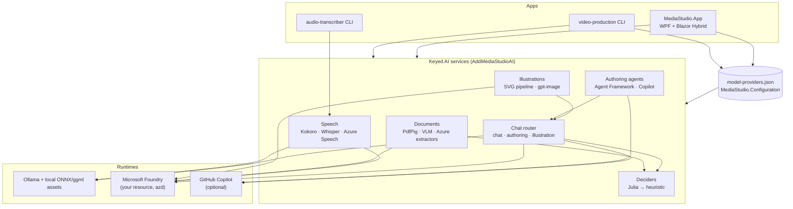

# Architecture

Media Studio is a .NET 11 solution ([`MediaStudio.slnx`](../MediaStudio.slnx)) with one desktop app, two
command-line tools, and a set of libraries that share one settings file and one AI wiring layer
(Microsoft.Extensions.AI).

Local runtimes are always tried first. Every path to Foundry or Copilot passes a cloud guard that refuses
the call unless `privacy.allowCloud` is on (and, for documents, you approve the upload).

## How a video is made

1. **Sources.** Notes, PDFs and recordings become source text ([documents](documents.md),
   [transcription](transcription.md)).
2. **Authoring.** An agent drafts a storyboard as typed, reviewable edits; nothing is applied without you
   ([routing](routing.md), [Copilot](copilot.md)).
3. **Narration and visuals.** Speech is synthesized per scene ([speech](speech.md)); illustrations are drawn
   as SVG ([illustrations](illustrations.md)); motion is rendered by the browser worker
   ([animated mechanisms](animated-mechanisms.md)).
4. **Production.** The production engine plans, approves, renders, checks and exports with FFmpeg. Every stage
   writes a receipt and its inputs are pinned by hash ([contracts](contracts.md),
   [file production](file-production.md)).

## Projects

| Project | Role |
| --- | --- |
| `src/MediaStudio.App` | The desktop app (WPF host, Blazor UI, setup wizard). Builds `MediaStudio.exe`. |
| `src/VideoProduction.Cli` | The `video-production` CLI: production stages, `configure`, `assets`, `bench`, `documents`. |
| `src/audio-transcriber` | The `audio-transcriber` CLI (Smart Tool, see [SMART_TOOL.md](../SMART_TOOL.md)). |
| `src/MediaStudio.Configuration` | Settings schema, migration, validation, `configure` commands, model assets, credentials, cloud guard. |
| `src/VideoProduction.Providers` | Keyed AI wiring (`AddMediaStudioAI`), chat router, illustration pipeline, benches. |
| `src/VideoProduction.Decisions` | Decision questions and clients (Julia, OpenAI Decisions, heuristic). |
| `src/VideoProduction.Core` | Production engine: projects, stages, receipts, captions, rendering, help text. |
| `src/VideoProduction.AgentFramework` | Microsoft Agent Framework SVG illustration generator. |
| `src/MediaStudio.Agents` | Authoring agents and tools (Agent Framework and GitHub Copilot), draft gateway. |
| `src/MediaStudio.Sources` | Document extraction, probing, routing and upload consent. |
| `src/MediaStudio.Speech` | Kokoro, Whisper.net and Azure Speech clients; speech benches. |
| `src/Media.Narration`, `src/Media.Audio` | Narration contracts, WAV handling and audio production. |
| `src/AudioTranscriber` | Transcription library used by the app and `audio-transcriber`. |
| `src/VideoStudio.Contracts` | Shared studio DTOs. |
| `workers/browser` | Node.js + Playwright worker for motion, capture and rasterization. |
| `infra/` | Bicep for one Foundry resource, model deployments and role assignments (`azd`). |
| `assets/model-manifest.json` | Local tiers and downloadable model assets with SHA-256 hashes. |
| `schemas/` | JSON schemas for projects, outlines, motion and file production. |
| `tests/` | Unit and integration tests (see [CONTRIBUTING](../CONTRIBUTING.md#build-and-test)). |

## AI services

`AddMediaStudioAI(settings)` (plus `AddMediaStudioDocuments(settings)` from `MediaStudio.Sources`) registers
keyed services from the settings file, so every app and tool resolves the same roles:

| Key | Type | Source |
| --- | --- | --- |
| `chat`, `authoring`, `illustration` | `IChatClient` | chat router over `chat.tiers` ([routing](routing.md)) |
| `vision` | `IChatClient` | `vision` role |
| `embedding` | `IEmbeddingGenerator` | `embeddings` role |
| `routing` | decision client | Julia → OpenAI Decisions → heuristic |
| `narration`, `transcription` | `ITextToSpeechClient`, `ISpeechToTextClient` | `speech` ([speech](speech.md)) |
| `documents`, `documents:<id>` | document extraction client | `documents` ([documents](documents.md)) |
| `illustration` | `IImageGenerator` | `images` ([illustrations](illustrations.md)) |

All clients use the standard logging and OpenTelemetry middleware. Settings are described in
[configuration](configuration.md).
