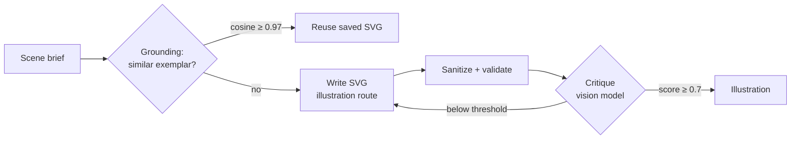

# Illustrations

Scene illustrations and project covers are **SVG drawn by a language model**, locally by default. The model
writes SVG markup; Media Studio cleans it to a safe subset, checks it, and can critique it with a vision model.
Raster images from gpt-image are an opt-in cloud mode.

## Pipeline



1. **Grounding.** The brief is embedded with the `embeddings` model. If the exemplar library holds a
   near-identical brief (cosine similarity ≥ 0.97, same palette), its SVG is reused and nothing is generated.
   Otherwise the closest exemplars are given to the model as style references. Exemplars are stored per user
   in `%LOCALAPPDATA%\MediaStudio\svg-library`.
2. **Writing SVG.** The keyed `illustration` chat client writes the markup. That is the [router](routing.md)
   (or the GitHub Copilot runtime when `agents.illustration.runtime` is `copilot`, see [Copilot](copilot.md)).
   Small local models often produce slightly broken SVG, so text is repaired and one invalid answer is retried.
3. **Sanitize and validate.** Only an allow-listed, inert subset of SVG is kept: no scripts, links, external
   images, style sheets or foreign objects. The viewBox is rescaled and size and depth limits are enforced.
   Anything that can't be repaired is rejected.
4. **Critique.** The `vision` model scores the result from 0 to 1. Below `threshold` (default 0.7) the image is
   regenerated with the listed issues, up to `maxRetries` (default 1) times, and the best-scoring result is kept.

The result is an `image/svg+xml` image. Each image carries receipts in its metadata: the critique score and
whether it passed, and the grounding used (exemplar reuse or references).

## Settings

```json
"images": {
  "mode": "svg",
  "deployment": "image",
  "grounding": true,
  "exemplars": true,
  "critique": { "enabled": true, "threshold": 0.7, "maxRetries": 1 }
}
```

| Setting | Effect |
| --- | --- |
| `mode` | `svg` (default, local-first) or `png` (gpt-image in Foundry; needs `privacy.allowCloud` and a Foundry connection, otherwise SVG is used). |
| `deployment` | Foundry image deployment for `png` mode (`image` from `azd up`). |
| `grounding` / `exemplars` | Turn exemplar reuse and style references off. Needs an `embeddings` model. |
| `critique` | Turn the vision critique off, or change its threshold (0–1) and retries (0–5). Needs a `vision` model. |

## In the app

Production uses this pipeline by default when no other illustration source is configured, and
**Settings illustration route (SVG)** in the illustration selector selects it explicitly. Explicit model
choices remain available. In production, grounding also uses the project's extracted source passages (up to
1024 passages), so illustrations reflect your documents. See [configuration](configuration.md#images) for the full settings file.

## Measuring

```powershell
dotnet run --project src/VideoProduction.Cli -- bench image --briefs 2
```

`bench image` generates illustrations for sample briefs and reports valid-SVG rate, critique scores and time.
On one dev machine (CPU, `qwen3.5:4b`), 2 of 2 briefs produced valid SVG; see [models](models.md#measured-results).

## Limitations

- The routed pipeline isn't available when the illustration role uses the GitHub Copilot runtime, because
  production runs in a background process; choose the router runtime for production illustrations.
- `png` mode (gpt-image) has been tested with fakes only.
