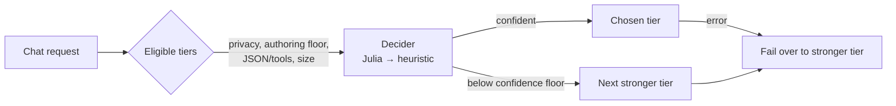

# Routing

Media Studio sends every chat request through one router. The router picks the **cheapest tier that can
do the job** and moves to a stronger tier only when it has to. With only local tiers configured, nothing
leaves your machine.



## How a request is routed

1. **Eligibility.** Each tier in `chat.tiers` (ordered weakest to strongest) is checked. A tier is skipped when
   it is a cloud tier and cloud is off (`cloud-disabled`), it is below the authoring floor for authoring work
   (`below-authoring-floor`), or it can't handle the request's JSON format, tools or size.
2. **Decision.** If more than one tier is eligible, a decider picks one and returns a probability for each.
   The decider sees the request's purpose and at most the last 16,000 characters of the conversation.
3. **Escalation.** If the chosen tier's probability is below `confidenceFloor` (default 0.6), the router uses
   the next stronger eligible tier instead.
4. **Failover.** If the chosen tier fails with a transient error (for example Ollama isn't running), the router
   tries the stronger eligible tiers in order. If the last local tier fails while cloud tiers were skipped, the
   request fails with `routing.local-unavailable`: "Local model unavailable; cloud is disabled in Settings."
   If no tier is eligible at all, it fails with `routing.no-eligible`.

Authoring purposes (`authoring`, `video-outline`, `storyboard`, `document-authoring`) never use a tier below
`authoringFloor` (default `balanced`), so storyboards aren't drafted by the smallest model.

## Deciders

The decider chain runs in order. Each link has a 2-second timeout, so routing always answers, even with no
models installed:

| Decider | Runs | Notes |
| --- | --- | --- |
| **Julia** | locally, ONNX Runtime | A small decision model (asset `julia-1`, about 600 MB). Used when installed and `decisions.julia` is `auto` or `on`. |
| **OpenAI Decisions** | Foundry `chat` deployment | Compiled out today; see [OpenAI SDK version](troubleshooting.md#openai-sdk-version). |
| **Heuristic** | locally | Rules based on purpose, length, JSON and tools. Always available. |

Install Julia with `assets ensure --id julia-1` (or `Setup-LocalModels.ps1`). `configure test` shows which
decider is active in the `decisions:julia` row.

## Settings

```json
"routing": { "decider": "auto", "confidenceFloor": 0.6, "authoringFloor": "balanced", "failover": true }
```

| Setting | Effect |
| --- | --- |
| `confidenceFloor` | Lower: trust the decider's first choice more often (cheaper). Higher: escalate more (better quality). |
| `authoringFloor` | Weakest tier allowed for authoring work. Use `fast` on small machines, `cloud` to always author in the cloud. |
| `failover` | `false` stops after the chosen tier fails instead of trying stronger tiers. |

Tiers are listed in [configuration](configuration.md#chat). Each tier can set `"thinking": true`; it is off by
default because reasoning makes small local models slow and can exhaust output limits.

## In the app

The router is registered per purpose (chat, authoring, illustration, video outlines and storyboards). In the
app's authoring and illustration selectors, choose **Settings routing** and **Settings
illustration route (SVG)** to use it; explicit per-model choices remain available. When GitHub Copilot is the
authoring or illustration runtime, the selector shows "GitHub Copilot".

## Observing decisions

- Every decision is attached to the response as `AdditionalProperties["media.chat.route"]` and traced as a
  `chat.route` activity on the `MediaStudio.Routing` ActivitySource (OpenTelemetry). It lists the eligible tiers,
  probabilities, chosen tier and reason (`decision-choice`, `low-confidence-escalated`, `failover`, …).
- Video planning writes the decision to the job's `chat-route.json`.
- `bench local` measures how often a local model agrees with the expected route; see
  [models](models.md#measured-results).
