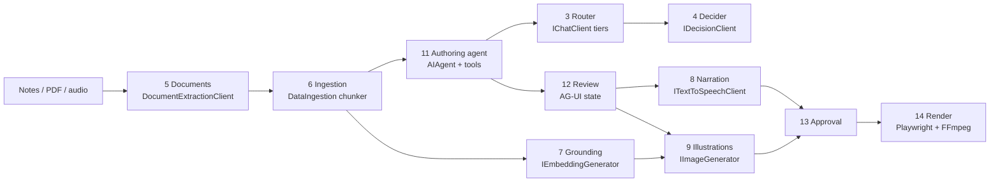

# Walkthrough: the .NET AI stack in Media Studio

This walkthrough follows one request through Media Studio: your notes or a PDF go in, and a narrated explainer video
comes out. At every stop it shows the code that does the work. It is modelled on the "The .NET AI Stack" talk from .NET Conf 2026
(BRK005), but it is less brief, and every snippet is copied from this repository rather than from slides.

Read it top to bottom for the story, or jump to a layer. Each stop has the same shape:

* **The idea** in one line, then why it matters.
* **Source:** a link to the exact lines in this repository.
* **The code**, verbatim. `// ...` marks lines left out; nothing else is changed. A test
  (`AgentGuidanceTests.Walkthrough_snippets_match_their_source`) fails when a snippet drifts from its source file.
* **Input / output / local / cloud / packages** at a glance.
* **Try it:** a command you can run. Commands are run from the repository root; `vp` is short for
  `dotnet run --project src/VideoProduction.Cli --`.

Model names are not repeated here. They live in [`assets/model-manifest.json`](../assets/model-manifest.json) (local) and
[`infra/models.json`](../infra/models.json) (Azure AI Foundry); [models](models.md) explains both.

## Contents

* [Follow one request](#follow-one-request)
* Models and decisions: [1. One set of keys](#1-one-set-of-keys-for-every-model) ·
  [2. Local first](#2-local-first-is-a-gate-not-a-default) · [3. Routing](#3-the-router-picks-a-tier-per-request) ·
  [4. Decisions](#4-decisions-are-a-small-model-not-a-chat-prompt)
* Context: [5. Documents](#5-documents-one-extractor-many-providers) ·
  [6. Ingestion](#6-ingestion-turns-extracted-text-into-cited-chunks) · [7. Grounding](#7-grounding-with-embeddings)
* Multimodal: [8. Hear it](#8-hear-it-narration-and-transcription) · [9. See it](#9-see-it-illustrations-as-an-image-generator)
* Tools, agents and experience: [10. Tools](#10-tools-the-agent-can-only-propose-typed-edits) ·
  [11. Agents](#11-agents-two-runtimes-one-contract) · [12. Experience](#12-experience-the-ui-applies-what-the-agent-proposes) ·
  [13. The person stays in charge](#13-the-person-stays-in-charge)
* Production: [14. How it becomes a film](#14-how-it-becomes-a-film) · [15. Guardrails on guidance](#15-guardrails-on-guidance)
* [Shared foundations](#shared-foundations) · [Configure and check](#configure-and-check) ·
  [What the code does not claim](#what-the-code-does-not-claim) · [Next reading](#next-reading)

## Follow one request

You drop a PDF of lecture notes into the desktop app and ask for a three-minute explainer.

1. **Read the source.** The document router probes the PDF. A digital PDF is read locally from its text layer; a scanned
   one goes to a local vision model or, only when you have allowed cloud *and* approved the upload, to an Azure
   extractor (stop 5).
2. **Cut it into citable pieces.** The extracted text becomes token-bounded chunks with section ids (stop 6), and
   optionally embeddings for retrieval (stop 7).
3. **Draft the storyboard.** An authoring agent reads the brief and the sources. Its only power is to propose typed
   edits through tools (stops 10–11). Each request goes to the weakest model tier that can handle it (stops 3–4).
4. **You review.** The app shows each proposal. You apply or reject it, and citations must point at real source
   sections (stop 12).
5. **Make sound and pictures.** Narration is synthesized per scene (stop 8); illustrations are drawn as SVG, grounded in
   your sources and checked (stop 9).
6. **Approve and render.** Nothing renders until a named person approves the exact plan. Then a browser worker draws
   frames and FFmpeg encodes the MP4 (stops 13–14).



Every arrow that could leave the machine passes the same privacy gate (stop 2).

---

## Models and decisions

### 1. One set of keys for every model

**The idea:** the app asks for a *role* ("chat", "vision", "embedding"), never for a vendor SDK. Settings decide what
sits behind each key.

Everything else in this walkthrough resolves AI services from dependency injection by a well-known key. That is what lets
the same app run on Ollama on a laptop, on Azure AI Foundry, or on GitHub Copilot, by changing settings and not code.

**Source:** [src/VideoProduction.Providers/ProviderFactory.cs](../src/VideoProduction.Providers/ProviderFactory.cs#L14-L23)

```csharp
public static class MediaStudioAIKeys
{
    public const string Chat = "chat";
    public const string Authoring = "authoring";
    public const string Illustration = "illustration";
    public const string Vision = "vision";
    public const string Embedding = "embedding";
    /// <summary>Key of the shared routing <see cref="IDecisionClient"/> (Julia → cloud → heuristic).</summary>
    public const string Decider = "routing";
}
```

`AddMediaStudioAI` registers those keys. Each chat purpose gets its own router, and every client gets the standard
logging and OpenTelemetry middleware from Microsoft.Extensions.AI:

**Source:** [src/VideoProduction.Providers/ProviderFactory.cs](../src/VideoProduction.Providers/ProviderFactory.cs#L59-L72)

```csharp
services.AddKeyedSingleton<IDecisionClient>(MediaStudioAIKeys.Decider, (sp, _) =>
    DecisionClientFactory.Create(settings, assets ?? TryDefaultAssets(), sp.GetService<ILoggerFactory>()));
if (settings.Chat.Tiers.Length > 0)
{
    foreach (var purpose in new[] { MediaStudioAIKeys.Chat, MediaStudioAIKeys.Authoring, MediaStudioAIKeys.Illustration }
                 .Where(key => !services.Any(d => d.ServiceType == typeof(IChatClient) && Equals(d.ServiceKey, key))))
        services.AddKeyedChatClient(purpose, sp => CreateRouter(settings, purpose,
                () => sp.GetRequiredKeyedService<IDecisionClient>(MediaStudioAIKeys.Decider),
                sp.GetServices<ITierChatClientFactory>(), sp.GetService<ILoggerFactory>()), ServiceLifetime.Singleton)
            .UseLogging().UseOpenTelemetry();
}
if (settings.Vision is { } vision && Allowed(settings, vision.Connection))
    services.AddKeyedChatClient(MediaStudioAIKeys.Vision, sp => CreateRoleClient(settings, vision,
        sp.GetServices<ITierChatClientFactory>()), ServiceLifetime.Singleton).UseLogging().UseOpenTelemetry();
```

Behind a key, one `switch` turns a *connection* from the settings file into an `IChatClient`. A local OpenAI-compatible
server (Ollama, llama.cpp, Foundry Local), a Foundry deployment and Claude on Foundry all come out as the same interface:

**Source:** [src/VideoProduction.Providers/ProviderFactory.cs](../src/VideoProduction.Providers/ProviderFactory.cs#L153-L174)

```csharp
switch (connection.Kind)
{
    case ConnectionKind.OpenAICompatible:
        var local = Chat(OpenAICompatible(connection), tier);
        return tier.Thinking == true ? local : local.AsBuilder()
            .ConfigureOptions(o => o.Reasoning ??= new() { Effort = ReasoningEffort.None }).Build();
    case ConnectionKind.Foundry when tier.Api == ChatApi.Anthropic:
        // ...
        return FoundryAnthropic.CreateClient(
    // ...
    case ConnectionKind.Foundry:
        return Chat(Foundry(connection), tier);
    default:
        var factory = (extensions ?? []).FirstOrDefault(f => f.Kind == connection.Kind)
        // ...
        return factory.Create(tier, connection, settings);
}
```

The `default` branch is the extension point: `ITierChatClientFactory` lets another assembly plug in a connection kind.
The GitHub Copilot tier is added this way by `MediaStudio.Agents`, so the providers library never references the Copilot
SDK.

| | |
| --- | --- |
| **Input** | `ProviderSettings` (the `model-providers.json` settings file) |
| **Output** | Keyed `IChatClient`, `IEmbeddingGenerator`, `IDecisionClient` and `IImageGenerator` services |
| **Local** | Any OpenAI-compatible server on loopback (Ollama by default) |
| **Cloud** | Azure AI Foundry (OpenAI-style and Claude deployments), GitHub Copilot |
| **Packages** | `Microsoft.Extensions.AI`, `Microsoft.Extensions.AI.OpenAI`, `OpenAI`, `Anthropic`, `Azure.Identity` |

**Try it:** `vp configure test` resolves every role and reports what it found.

### 2. Local first is a gate, not a default

**The idea:** one function decides whether anything may leave the machine, and every cloud path calls it.

`privacy.allowCloud` is `false` until you turn it on. It is not just a default value in a wizard: chat tiers, speech,
document extractors, agents and image generation all ask the same guard before they send a byte.

**Source:** [src/MediaStudio.Configuration/CloudGuard.cs](../src/MediaStudio.Configuration/CloudGuard.cs#L7-L36)

```csharp
public static class CloudGuard
{
    /// <summary>True when the work is local, or it is cloud work and <c>privacy.allowCloud</c> is true.</summary>
    public static bool Allows(bool allowCloud, bool isCloud) => !isCloud || allowCloud;
    // ...
    public static void Require(bool allowCloud, string what, bool isCloud = true, string? alternative = null)
    {
        if (Allows(allowCloud, isCloud)) return;
        throw new InvalidOperationException(
            $"{what} uses a cloud service but privacy.allowCloud is false. Enable cloud in settings"
            + (alternative is null ? "." : $", or {alternative}."));
    }
}
```

The chat tier factory repeats the check with its own error code, so a misconfigured tier fails before a client exists:

**Source:** [src/VideoProduction.Providers/ProviderFactory.cs](../src/VideoProduction.Providers/ProviderFactory.cs#L150-L151)

```csharp
Guard.Require(!connection.IsCloud || settings.Privacy.AllowCloud, "routing.cloud-disabled",
    $"Connection '{connection.Id}' is a cloud connection and cloud is disabled in Settings.");
```

| | |
| --- | --- |
| **Input** | `privacy.allowCloud` and whether the target is cloud |
| **Output** | Allowed, or an error that names the setting and the local alternative |
| **Local** | Always allowed |
| **Cloud** | Allowed only when you opt in; documents also need per-upload consent (stop 5) |
| **Packages** | None; plain .NET in `MediaStudio.Configuration` |

**Try it:** `vp configure test --cloud-only` with cloud off shows which rows are skipped and why.

### 3. The router picks a tier per request

**The idea:** the chat client the app uses is itself a router. It asks a decision model which tier can handle this
request, escalates when the answer is not confident, and fails over to stronger tiers.

Tiers are ordered weakest to strongest (`fast`, `balanced`, then cloud or Copilot). `DecisionRoutingChatClient` builds on
the experimental `FailoverChatClient` from Microsoft.Extensions.AI and adds the choice:

**Source:** [src/VideoProduction.Providers/ChatRouting.cs](../src/VideoProduction.Providers/ChatRouting.cs#L105-L110)

```csharp
public sealed class DecisionRoutingChatClient : FailoverChatClient
{
    public const string ReceiptKey = "media.chat.route";
    /// <summary>Shown whenever a cloud model would be needed while Settings keep everything on this machine.</summary>
    public const string CloudDisabledMessage = "Local model unavailable; cloud is disabled in Settings.";
    public const string ActivitySourceName = "MediaStudio.Routing";
```

The core of `Plan`: tiers that privacy settings exclude are removed first, then the decider sees the request state and
one choice question. A low-confidence answer moves one tier up; the failover order starts at the chosen tier.

**Source:** [src/VideoProduction.Providers/ChatRouting.cs](../src/VideoProduction.Providers/ChatRouting.cs#L229-L280)

```csharp
var domain = tiers.Where(t => eligible.Single(e => e.Name == t.Name).Eligible).ToArray();
// ...
    Guard.Require(options.AllowCloud || !options.DeciderIsCloud,
        "routing.scorer-privacy", "Local-only policy cannot send request state to a cloud decision scorer.");
    // ...
        response = await decision.Value.GetResponseAsync(state, ChatRoutingJson.Default.ChatRouteState,
            [Question(domain)], cancellationToken: cancellationToken);
    // ...
    var uncertain = selected.Probability == other || selected.Probability < options.ConfidenceFloor
        || selected.Probability - other < options.MinimumMargin;
    var index = Array.FindIndex(domain, t => t.Name == selected.Name);
    var route = uncertain && index < domain.Length - 1 ? domain[index + 1] : domain[index];
    var reason = !uncertain ? "decision-choice" : route == domain[index] ? "low-confidence-strongest" : "low-confidence-escalated";
// ...
var start = Array.FindIndex(domain, t => t.Name == receipt.SelectedRoute);
var order = options.Failover ? domain[start..] : [domain[start]];
```

Every response carries a route receipt under `media.chat.route` (the chosen tier, the probabilities and the reason), and
the `MediaStudio.Routing` activity source traces it. Authoring requests can have a floor (`chat.routing.authoringFloor`)
so long structured output never starts on the smallest model, but a floor you cannot reach is ignored rather than
blocking local work (see `CreateRouter`).

| | |
| --- | --- |
| **Input** | Chat messages and options; tiers from `chat.tiers` |
| **Output** | A `ChatResponse` from one tier, plus a route receipt |
| **Local** | `fast` and `balanced` tiers on Ollama |
| **Cloud** | `cloud`, `strong` (Foundry) and `copilot` tiers, only when allowed |
| **Packages** | `Microsoft.Extensions.AI` (experimental routing, diagnostic `AIRoutingChat`) |

**Try it:** `vp bench chat` measures every configured tier; `vp bench local` scores your installed Ollama models on
routing and storyboard cases so you can choose tiers for your machine. [Routing](routing.md) explains the floors and
settings.

### 4. Decisions are a small model, not a chat prompt

**The idea:** "which tier?" and "which extractor?" are classification questions. A small local model answers them as
probabilities, with no chat model in the loop.

`IDecisionClient` is this repository's experimental contract (diagnostic `VPD001`) for asking typed questions (binary,
choice and score) about a JSON request state:

**Source:** [src/VideoProduction.Decisions/Contract/DecisionClient.cs](../src/VideoProduction.Decisions/Contract/DecisionClient.cs#L26-L42)

```csharp
[Experimental(DiagnosticIds.Experiments.AIDecisions, UrlFormat = DiagnosticIds.UrlFormat)]
public interface IDecisionClient : IDisposable
{
    // ...
    Task<DecisionResponse> GetResponseAsync(
        DecisionRequest request,
        DecisionOptions? options = null,
        CancellationToken cancellationToken = default);
    // ...
    object? GetService(Type serviceType, object? serviceKey = null);
}
```

The default implementation is **Julia**, a small ONNX classifier. Its tokenizer wraps the pinned HuggingFace tokenizer
behind the `Microsoft.ML.Tokenizers` abstraction, and its logits become probabilities with `TensorPrimitives`, a
numerically stable softmax in three calls:

**Source:** [src/VideoProduction.Decisions/Julia/DecodeDecisions.cs](../src/VideoProduction.Decisions/Julia/DecodeDecisions.cs#L38-L48)

```csharp
double[] probabilities = new double[values.Length];
TensorPrimitives.Subtract<double>(values, TensorPrimitives.Max<double>(values), probabilities);
TensorPrimitives.Exp<double>(probabilities, probabilities);
TensorPrimitives.Divide<double>(probabilities, TensorPrimitives.Sum<double>(probabilities), probabilities);
DecisionAnswer answer = q switch {
    BinaryDecisionQuestion => new BinaryDecisionAnswer(q.Id, probabilities[1]),
    ChoiceDecisionQuestion c => new ChoiceDecisionAnswer(q.Id, c.Candidates[Array.IndexOf(probabilities, probabilities.Max())].Id,
        c.Candidates.Select((c, i) => KeyValuePair.Create(c.Id, probabilities[i]))),
    ScoreDecisionQuestion => new ScoreDecisionAnswer(q.Id, probabilities),
    _ => throw new NotSupportedException()
};
```

Deciders form a fallback chain: Julia when its asset is installed, then a cloud decider only in builds that define
`OPENAI_DECISIONS` and only with cloud allowed, then a heuristic that always answers. A missing model degrades routing
quality; it never breaks the app.

**Source:** [src/VideoProduction.Providers/Decisions/DecisionClientFactory.cs](../src/VideoProduction.Providers/Decisions/DecisionClientFactory.cs#L36-L55)

```csharp
if (decider != "heuristic" && settings.Decisions.Julia != JuliaMode.Off)
{
    // ...
    if (directory is not null)
        chain.Add(new LazyDecisionClient("julia", () => (juliaLoader ?? LoadJulia)(directory)));
    // ...
}
#if OPENAI_DECISIONS
if (decider is "auto" or "openai" && settings.Privacy.AllowCloud
    && settings.Connections.FirstOrDefault(c => c.Kind == ConnectionKind.Foundry) is { } foundry)
    chain.Add(new LazyDecisionClient("openai", () => CreateFoundryDecisions(foundry, settings.Decisions.CloudDeployment)));
#endif
chain.Add(new HeuristicDecisionClient(choiceRule));
return new FallbackDecisionClient(chain, logger);
```

| | |
| --- | --- |
| **Input** | A JSON request state and a batch of typed questions |
| **Output** | One answer per question with probabilities and provenance |
| **Local** | Julia (ONNX Runtime), heuristic |
| **Cloud** | OpenAI decisions on Foundry (not in the default build) |
| **Packages** | `Microsoft.ML.OnnxRuntime`, `Microsoft.ML.Tokenizers`, `Tokenizers.HuggingFace`, `System.Numerics.Tensors` |

**Try it:** `vp assets ensure --id julia-1` installs Julia; `vp configure test` then checks it.

---

## Context

### 5. Documents: one extractor, many providers

**The idea:** every document reader (local PDF text, a local vision model, three Azure services) is a
`DocumentExtractionClient`. A routing client in front of them picks the cheapest one that will work.

`Microsoft.Extensions.DocumentExtraction` defines the abstraction, and the `CommunityToolkit.DocumentExtraction.*`
packages supply the providers. The factory builds the candidates; every remote one is wrapped in a consent gate before
anything else sees it:

**Source:** [src/MediaStudio.Sources/Routing/DocumentExtractorFactory.cs](../src/MediaStudio.Sources/Routing/DocumentExtractorFactory.cs#L102-L120)

```csharp
DocumentExtractionClient Gate(DocumentExtractionClient client) =>
    new ConsentGatedDocumentExtractionClient(client, DisplayName(name), consent, allowCloud);
switch (name)
{
    case DocumentCandidates.PdfPig:
        return new(name, "Reads the PDF's embedded text layer locally. Fast and exact for digital PDFs; returns nothing for scanned pages.",
            false, new PdfPigDocumentExtractionClient(), SupportsImages: false);
    case DocumentCandidates.Vlm when vision is not null:
        DocumentExtractionClient reader = new PdfPageImagesDocumentExtractionClient(
            new VisionLanguageModelDocumentExtractionClient(vision, new()));
        return new(name, "Local vision-language model that transcribes scanned pages and images. Slower; no upload.",
            visionIsRemote, visionIsRemote ? Gate(reader) : reader);
}
// ...
    DocumentCandidates.DocumentIntelligence => new(name,
        "Azure Document Intelligence prebuilt-layout: OCR with tables, forms and reading order. Cloud upload.", true,
        Gate(new LazyDocumentExtractionClient(() => DocumentIntelligence(endpoints.DocumentIntelligence, connection, options)))),
```

The vision reader is worth a second look: `VisionLanguageModelDocumentExtractionClient` takes any `IChatClient` with
vision, here the keyed `vision` role from stop 1. A local multimodal model in Ollama becomes an OCR engine with no extra
SDK.

The "Auto" extractor plans before it extracts. Remote candidates are dropped when cloud is off; a digital PDF goes
straight to the local text layer; otherwise the decider from stop 4 ranks the rest, and the prompt says to prefer local:

**Source:** [src/MediaStudio.Sources/Routing/DecisionRoutingDocumentExtractionClient.cs](../src/MediaStudio.Sources/Routing/DecisionRoutingDocumentExtractionClient.cs#L46-L60)

```csharp
var eligible = candidates.Where(c => c.Fits(probe) && (!c.IsRemote || CloudGuard.Allows(allowCloud, true))).ToArray();
if (eligible.Length == 0)
    return new(probe, [], "none", "No configured extractor accepts this document (type, size or privacy settings).");
var pdfpig = eligible.FirstOrDefault(c => c.Name == DocumentCandidates.PdfPig);
if (probe.IsDigital && pdfpig is not null)
    return new(probe, [pdfpig, .. eligible.Where(c => c != pdfpig)], "fast-path", "Digital PDF: the text layer is read locally.");

var rules = DocumentRoutingRules.Rank(probe, eligible);
// ...
    var question = new ChoiceDecisionQuestion(QuestionId,
        "Choose the document extractor most likely to return complete, accurate text for this document. Prefer local extractors when they are likely to succeed.",
        eligible.Select(c => new DecisionCandidate(c.Name, c.Description)).ToArray());
```

Extraction then walks the ranked list. A result that is too thin for the page count (`ExtractionQuality`) moves on to
the next candidate, a declined upload is recorded rather than retried, and if nothing is good enough the best partial
result is returned and flagged as low quality:

**Source:** [src/MediaStudio.Sources/Routing/DecisionRoutingDocumentExtractionClient.cs](../src/MediaStudio.Sources/Routing/DecisionRoutingDocumentExtractionClient.cs#L95-L119)

```csharp
foreach (var candidate in plan.Ranked)
{
    // ...
        var result = await candidate.Client.ExtractAsync(input, identifier, mediaType, options, cancellationToken).ConfigureAwait(false);
        DocumentExtractionTags.Stamp(result, candidate.Name, candidate.Client);
        if (ExtractionQuality.IsAcceptable(result, probe))
        {
            attempts.Add($"{candidate.Name}:ok");
            result.Metadata[DocumentExtractionTags.Attempts] = string.Join(", ", attempts);
            return result;
        }
    // ...
    catch (UploadConsentDeniedException denied)
    {
        attempts.Add($"{candidate.Name}:declined");
        failures.Add(denied);
    }
```

The consent gate is a `DelegatingDocumentExtractionClient`-style wrapper. It checks the cloud setting, asks *you* about
this specific file and provider, and only then calls the inner client:

**Source:** [src/MediaStudio.Sources/Routing/UploadConsent.cs](../src/MediaStudio.Sources/Routing/UploadConsent.cs#L64-L74)

```csharp
public override async Task<ExtractionDocument> ExtractAsync(Stream document, string identifier, string mediaType,
    DocumentExtractionOptions? options = null, CancellationToken cancellationToken = default)
{
    ArgumentNullException.ThrowIfNull(document);
    if (!CloudGuard.Allows(allowCloud, isCloud: true))
        throw new UploadConsentDeniedException(identifier, ProviderName,
            $"{ProviderName} is a cloud service and privacy.allowCloud is false; nothing was sent.");
    if (!await consent.RequestAsync(identifier, ProviderName, cancellationToken).ConfigureAwait(false))
        throw new UploadConsentDeniedException(identifier, ProviderName);
    return await base.ExtractAsync(document, identifier, mediaType, options, cancellationToken).ConfigureAwait(false);
}
```

Registration uses the keyed helper from the abstraction package, and the default consent is *deny*: a host that never
registers an `IUploadConsent` can never upload.

**Source:** [src/MediaStudio.Sources/Routing/DocumentExtractorFactory.cs](../src/MediaStudio.Sources/Routing/DocumentExtractorFactory.cs#L199-L202)

```csharp
services.AddKeyedDocumentExtractionClient(MediaStudioDocumentKeys.Documents, sp => DocumentExtractorFactory.CreateRouter(settings,
    sp.GetKeyedService<IChatClient>(MediaStudioDocumentKeys.Vision), sp.GetKeyedService<IDecisionClient>(MediaStudioDocumentKeys.Decider),
    sp.GetService<IUploadConsent>() ?? FixedUploadConsent.Deny, sp.GetService<ILoggerFactory>(), visionIsRemote: visionIsRemote),
    ServiceLifetime.Singleton);
```

| | |
| --- | --- |
| **Input** | A document stream and media type (PDF or image) |
| **Output** | An `ExtractionDocument` (pages, elements, Markdown) tagged with the extractor and attempts |
| **Local** | PdfPig (text layer), a vision-language model through the `vision` chat client |
| **Cloud** | Azure Document Intelligence, Azure Content Understanding, Mistral OCR on Foundry, each behind consent |
| **Packages** | `Microsoft.Extensions.DocumentExtraction`, `CommunityToolkit.DocumentExtraction.PdfPig`, `.VisionLanguageModel`, `.AzureDocumentIntelligence`, `.AzureContentUnderstanding`, `.Mistral` |

**Try it:** `vp documents probe <file.pdf>` shows the probe and the ranked plan without extracting;
`vp documents probe <file.pdf> --extract` runs it; `vp bench documents <file.pdf>` compares every eligible extractor.
[Documents](documents.md) has the full routing rules.

### 6. Ingestion turns extracted text into cited chunks

**The idea:** extraction output is bridged into `Microsoft.Extensions.DataIngestion`, and its chunker cuts each page into
token-bounded pieces with stable section ids that the agent must cite.

The bridge is a standard `IngestionDocumentReader`, so any extractor from stop 5 can feed the ingestion pipeline:

**Source:** [src/MediaStudio.Sources/DocumentSources.cs](../src/MediaStudio.Sources/DocumentSources.cs#L76-L84)

```csharp
public sealed class ExtractionIngestionReader(DocumentExtractionClient client, DocumentExtractionOptions? options = null) : IngestionDocumentReader
{
    public ExtractionDocument? LastExtraction { get; private set; }
    public override async Task<IngestionDocument> ReadAsync(Stream source, string identifier, string mediaType,
        CancellationToken cancellationToken = default)
    {
        LastExtraction = await client.ExtractAsync(source, identifier, mediaType, options, cancellationToken);
        return Bridge(LastExtraction);
    }
```

Chunking runs per page, so a chunk never spans two pages and every citation can name the page it came from:

**Source:** [src/MediaStudio.Sources/DocumentSources.cs](../src/MediaStudio.Sources/DocumentSources.cs#L429-L441)

```csharp
// Chunk each source page independently; generic chunk metadata is not an attribution guarantee.
var content = document.EnumerateContent().Where(e => !string.IsNullOrWhiteSpace(e.GetMarkdown())).ToArray();
foreach (var group in content.GroupBy(e => (e.PageNumber, PageId: e.Metadata.TryGetValue("sourcePageId", out var value) ? value as string : null)))
{
    // ...
    var chunker = new DocumentTokenChunker(new IngestionChunkerOptions(tokenizer) { MaxTokensPerChunk = 512, OverlapTokens = 0 });
    await foreach (var chunk in chunker.ProcessAsync(bounded, ct))
    {
        result.Add(new("section-" + (result.Count + 1), group.Key.PageId, group.Key.PageNumber, chunk.Content,
            tokenizer.CountTokens(chunk.Content)));
```

| | |
| --- | --- |
| **Input** | An `ExtractionDocument` |
| **Output** | Source chunks (`section-N`, page, text, token count) plus honest warnings for pages with no text |
| **Local** | Entirely local; the tokenizer is `cl100k_base` from `Microsoft.ML.Tokenizers` |
| **Cloud** | None |
| **Packages** | `Microsoft.Extensions.DataIngestion`, `Microsoft.ML.Tokenizers`, `Microsoft.ML.Tokenizers.Data.Cl100kBase` |

### 7. Grounding with embeddings

**The idea:** when an embedding model is configured, source chunks are embedded once and the most relevant ones are
pulled into illustration prompts. No vector database is needed; it is a list and a cosine.

**Source:** [src/VideoProduction.Providers/Illustrations/SourceIndex.cs](../src/VideoProduction.Providers/Illustrations/SourceIndex.cs#L67-L74)

```csharp
public async Task<IReadOnlyList<VectorMatch<SourcePassage>>> TopKAsync(string query, int k = DefaultTopK,
    CancellationToken cancellationToken = default)
{
    ArgumentException.ThrowIfNullOrWhiteSpace(query);
    if (index.Count == 0) return [];
    var vector = await embeddings.GenerateVectorAsync(query, cancellationToken: cancellationToken).ConfigureAwait(false);
    return TopK(vector, k);
}
```

**Source:** [src/VideoProduction.Providers/Illustrations/VectorIndex.cs](../src/VideoProduction.Providers/Illustrations/VectorIndex.cs#L56-L60)

```csharp
return entries
    .Select((e, i) => (e.Item, Score: TensorPrimitives.CosineSimilarity(query.Span, e.Vector), Index: i))
    .Where(e => filter is null || filter(e.Item))
    .OrderByDescending(e => e.Score).ThenBy(e => e.Index)
    .Take(k).Select(e => new VectorMatch<T>(e.Item, e.Score)).ToArray();
```

The same index backs the SVG exemplar library: a new illustration brief that is nearly identical to an earlier one
(and uses the same palette) reuses that SVG instead of calling a model at all.

| | |
| --- | --- |
| **Input** | Source passages and a query (the illustration brief) |
| **Output** | Top-k passages with cosine scores |
| **Local** | An embedding model on Ollama through `IEmbeddingGenerator` |
| **Cloud** | A Foundry embedding deployment, when allowed |
| **Packages** | `Microsoft.Extensions.AI`, `System.Numerics.Tensors` |

---

## Multimodal

### 8. Hear it: narration and transcription

**The idea:** speech uses the Microsoft.Extensions.AI speech abstractions, `ITextToSpeechClient` and
`ISpeechToTextClient`. The default engines run on your machine.

Kokoro is a local text-to-speech model: espeak-ng turns text into phonemes, a tokenizer maps them to ids, and ONNX
Runtime produces audio. To the rest of the app it is just another MEAI client:

**Source:** [src/MediaStudio.Speech/Kokoro/KokoroTextToSpeechClient.cs](../src/MediaStudio.Speech/Kokoro/KokoroTextToSpeechClient.cs#L55-L127)

```csharp
/// <summary>
/// Local Kokoro-82M text-to-speech: sentence split → espeak-ng IPA → <see cref="KokoroPhonemeTokenizer"/> (≤ 510 ids per chunk)
/// → ONNX Runtime → cross-faded, peak-normalized 24 kHz mono PCM16 WAV.
/// </summary>
public sealed class KokoroTextToSpeechClient : ITextToSpeechClient
{
    public const string ProviderName = "kokoro";
    // ...
    public async Task<TextToSpeechResponse> GetAudioAsync(string text, TextToSpeechOptions? options = null, CancellationToken cancellationToken = default)
    {
        // ...
        var wav = WavFile.ToPcm16Wav(joined, KokoroModel.SampleRate);
        var raw = new KokoroSynthesisResult(text, text, KokoroModel.SampleRate, joined.Length, chunks, Provenance(request));
        return new TextToSpeechResponse([new DataContent(wav, "audio/wav")]) {
```

The speech factory picks the engine from settings. The cloud branch (Azure Speech, including MAI voices) goes through
`CloudGuard` first, and its error message names the local alternative:

**Source:** [src/MediaStudio.Speech/SpeechClientFactory.cs](../src/MediaStudio.Speech/SpeechClientFactory.cs#L29-L71)

```csharp
switch (tts.Provider)
{
    case TtsProvider.Kokoro:
        var fp32 = string.Equals(tts.Quality, "fp32", StringComparison.OrdinalIgnoreCase);
        return new KokoroTextToSpeechClient(KokoroAssetPaths.FromModelAssets(Assets, fp32), options: new() {
            DefaultVoice = string.IsNullOrWhiteSpace(tts.Voice) ? "af_heart" : tts.Voice,
            DefaultSpeed = (float)tts.Speed
        });
    case TtsProvider.AzureSpeech:
        var connection = CloudConnection(tts.Connection, "speech.tts");
        // ...
}
// ...
    CloudGuard.Require(Settings, setting, alternative: $"switch {setting}.provider to the local engine");
```

The narration stage calls the client through the abstraction and is strict about what comes back. There is no silent
fallback to another voice, and the response must be exactly one WAV:

**Source:** [src/Media.Narration/Speech.cs](../src/Media.Narration/Speech.cs#L36-L47)

```csharp
response = await client.GetAudioAsync(displayText, new TextToSpeechOptions {
    VoiceId = request.Voice, Language = request.Language, Speed = request.Speed, Volume = 1, AudioFormat = "wav"
}, ct);
// ...
catch (Exception error)
{
    throw new VideoException("speech.client", $"MEAI client failed; no fallback: {error.GetType().Name}: {error.Message}");
}
ct.ThrowIfCancellationRequested();
Guard.Require(response is not null && response.Contents.Count == 1 && response.Contents[0] is DataContent { MediaType: "audio/wav" },
    "speech.audio", "Client must return exactly one explicit audio/wav DataContent; no URI/download fallback.");
```

Transcription runs the other way. Whisper.net streams segments with real timestamps:

**Source:** [src/MediaStudio.Speech/Whisper/WhisperNetSpeechToTextClient.cs](../src/MediaStudio.Speech/Whisper/WhisperNetSpeechToTextClient.cs#L84-L89)

```csharp
await foreach (var segment in ProcessAsync(audioSpeechStream, options, cancellationToken).ConfigureAwait(false))
{
    yield return new SpeechToTextResponseUpdate(segment.Text.Trim()) {
        Kind = SpeechToTextResponseUpdateKind.TextUpdated,
        StartTime = segment.Start,
        EndTime = segment.End,
```

Captions and audio-only productions depend on those timestamps, so the transcription engine refuses a provider that does
not return them, or returns overlapping segments:

**Source:** [src/AudioTranscriber/MeaiTranscriptionEngine.cs](../src/AudioTranscriber/MeaiTranscriptionEngine.cs#L19-L29)

```csharp
await foreach (var update in client.GetStreamingTextAsync(stream,
    new SpeechToTextOptions { SpeechLanguage = "en", SpeechSampleRate = 16000 },
    cancellationToken).ConfigureAwait(false))
{
    cancellationToken.ThrowIfCancellationRequested();
    if (string.IsNullOrWhiteSpace(update.Text)) continue;
    if (update.StartTime is not { } start || update.EndTime is not { } end)
        throw new InvalidDataException("Speech provider returned text without actual segment timestamps.");
    var segment = new TranscriptSegment(update.Text, start, end);
    if (segment.End > audio.Duration || segments.Count > 0 && segment.Start < segments[^1].End)
        throw new InvalidDataException("Speech provider returned out-of-range or overlapping segments.");
```

Push-to-talk dictation in the app uses local Whisper by default. The optional cloud mode uses the MEAI realtime
abstraction (`IRealtimeClient`) to stream microphone audio and show words as you speak:

**Source:** [src/MediaStudio.App/RealtimeDictation.cs](../src/MediaStudio.App/RealtimeDictation.cs#L61-L64)

```csharp
public static async Task<RealtimeDictation> StartAsync(IRealtimeClient client, Action<string> provisional, CancellationToken cancellationToken,
    string? cloudModel = null)
{
    var session = await client.CreateSessionAsync(cloudModel is null ? RealtimeSpeechInput.Options : CloudSpeechInput.Options(cloudModel), cancellationToken).ConfigureAwait(false);
```

| | |
| --- | --- |
| **Input** | Narration text and voice options; or a WAV file or microphone audio |
| **Output** | A 24 kHz WAV per scene; or timed transcript segments |
| **Local** | Kokoro + espeak-ng (TTS), Whisper.net (STT and dictation) |
| **Cloud** | Azure Speech with MAI voices, MAI-Transcribe, OpenAI realtime transcription, each opt-in |
| **Packages** | `Microsoft.Extensions.AI.Abstractions`, `Microsoft.ML.OnnxRuntime`, `Whisper.net`, `Whisper.net.Runtime` |

**Try it:** `vp bench tts --local-only` measures Kokoro narration speed; `vp bench stt --local-only` measures Whisper
word error rate on clips it synthesizes with Kokoro.
[Speech](speech.md) and [transcription](transcription.md) cover voices, models and cloud setup.

### 9. See it: illustrations as an image generator

**The idea:** illustrations come from `IImageGenerator`. The default generator is a chat model that writes SVG, wrapped
in decorators that ground it in your sources and critique the result.

Decorators compose the same way as the MEAI chat middleware. The first `Use` is the outermost layer:

**Source:** [src/VideoProduction.Providers/Illustrations/IllustrationPipeline.cs](../src/VideoProduction.Providers/Illustrations/IllustrationPipeline.cs#L34-L42)

```csharp
// The first Use() is the outermost decorator.
var builder = baseGenerator.AsBuilder();
if (settings.Grounding && embeddings is not null)
    builder.Use(inner => new GroundedImageGenerator(inner, embeddings, () => sources?.Sources,
        settings.Exemplars ? sources?.Exemplars : null, loggerFactory?.CreateLogger<GroundedImageGenerator>()));
if (settings.Critique.Enabled && vision is not null)
    builder.Use(inner => new CritiquingImageGenerator(inner, vision, settings.Critique,
        loggerFactory?.CreateLogger<CritiquingImageGenerator>()));
return builder.Build();
```

The base generator is local first. It is `ChatSvgImageGenerator` over the keyed `illustration` chat client (the router
from stop 3). A cloud raster model (gpt-image) replaces it only in `png` mode with cloud allowed:

**Source:** [src/VideoProduction.Providers/Illustrations/IllustrationPipeline.cs](../src/VideoProduction.Providers/Illustrations/IllustrationPipeline.cs#L70-L75)

```csharp
services.AddKeyedImageGenerator(MediaStudioAIKeys.Illustration, sp =>
{
    var baseGenerator = cloudImage is not null
        ? CreateCloudImageGenerator(cloudImage, settings.Images.Deployment)
        : new ChatSvgImageGenerator(sp.GetRequiredKeyedService<IChatClient>(MediaStudioAIKeys.Illustration),
            MediaStudioAIKeys.Illustration, sp.GetService<SvgRasterConfiguration>(), svgOptions: new ChatSvgOptions());
```

The model's SVG is untrusted output. Before it is used it is sanitized and validated (no scripts, external references or
unbounded sizes), with one fresh attempt when a small local model produces something unrepairable:

**Source:** [src/VideoProduction.Providers/ChatSvgImageGenerator.cs](../src/VideoProduction.Providers/ChatSvgImageGenerator.cs#L145-L160)

```csharp
for (var attempt = 0; ; attempt++)
{
    var response = await GenerateSvgAsync(request, size, cancellationToken);
    string svg;
    try
    {
        svg = svgOptions?.Sanitize == true
            ? Illustrations.SvgSanitizer.Sanitize(response.Text, size.Width, size.Height)
            : SafeSvg.Validate(response.Text, size.Width, size.Height);
    }
    catch (VideoException error) when (error.Code == "image.svg" && attempt < (svgOptions?.InvalidOutputRetries ?? 0))
    {
        continue;
    }
    return await RenderAsync(request.Prompt!, response, svg, size, cancellationToken);
}
```

Because the generator only needs an `IChatClient`, an Agent Framework agent can draw too. `AsIChatClient` adapts the
agent, and the adapter refuses to run unless the host has confirmed that the agent's tools are denied:

**Source:** [src/VideoProduction.AgentFramework/AgentSvgImageGenerator.cs](../src/VideoProduction.AgentFramework/AgentSvgImageGenerator.cs#L18-L23)

```csharp
Guard.Require(acknowledgement is { ToolsDenied: true, NoPersistedHistory: true, ProviderOptionsMayBeIgnored: true },
// ...
client = agent.AsIChatClient(allowNonChatClientAgents: true);
#pragma warning restore MAAI001
inner = new ChatSvgImageGenerator(client, configuredModel, raster);
```

| | |
| --- | --- |
| **Input** | An illustration brief and size |
| **Output** | Validated SVG (or PNG when rasterized or in cloud mode) |
| **Local** | A chat model on Ollama writes SVG; a local vision model critiques it |
| **Cloud** | gpt-image on Foundry (`png` mode), Copilot as the illustration runtime, each opt-in |
| **Packages** | `Microsoft.Extensions.AI`, `Microsoft.Agents.AI` |

**Try it:** `vp bench image` draws a set of test illustrations and reports validity and timing.
[Illustrations](illustrations.md) covers grounding, exemplars and critique.

---

## Tools, agents and experience

### 10. Tools: the agent can only propose typed edits

**The idea:** the authoring agent cannot write files or run commands. Its whole capability is a small set of
`AIFunction`s that propose edits to the draft.

**Source:** [src/MediaStudio.Agents/MediaDraftTool.cs](../src/MediaStudio.Agents/MediaDraftTool.cs#L64-L71)

```csharp
tools.Add(Create(ReviseDirection, "revise_creative_direction", "Revise creative teaching direction only. This does not change output intent or authorize production."));
tools.Add(Create(UpdateBrief, "update_creative_brief", "Change only supplied title, brief, audience or outcome fields. Preserve unspecified fields."));
tools.Add(Create(SetItemTarget, "set_item_target", "Set a creative duration target in seconds for one existing item. This is not a measured production clock."));
return tools;
static AIFunction Create(Delegate method, string name, string description) =>
    AIFunctionFactory.Create(method, new AIFunctionFactoryOptions {
        Name = name, Description = description, SerializerOptions = Json.Options
    });
```

The tool set depends on the output. Video drafts get scene tools (add, update, move, animate); audio drafts get
audio-part tools. The tool descriptions spell out bounds and say that "a rejection is not an applied edit". The
descriptions are part of the contract with the model.

| | |
| --- | --- |
| **Input** | Typed arguments from the model |
| **Output** | A draft transaction or a typed rejection; never a saved project |
| **Packages** | `Microsoft.Extensions.AI` (`AIFunctionFactory`) |

### 11. Agents: two runtimes, one contract

**The idea:** the same authoring agent and tools run on Microsoft Agent Framework (over any `IChatClient`, local by
default) or on the GitHub Copilot SDK. The app does not need to know which one is running.

**Source:** [src/MediaStudio.Agents/AuthoringAgentFactory.cs](../src/MediaStudio.Agents/AuthoringAgentFactory.cs#L5-L14)

```csharp
public enum AuthoringRuntime { Maf, Copilot }
// ...
// First version: "maf" wraps a provided IChatClient in a ChatClientAgent; "copilot" keeps the existing
// Copilot SDK path. Both expose the same bounded media-draft tool over AG-UI.
public static class AuthoringAgentFactory
{
    public static CopilotAuthoringAgent CreateMaf(IChatClient chatClient, string model, string providerName,
        MediaDraftTool? draftTool = null)
```

The Copilot runtime is a full coding agent, so Media Studio locks it down hard. Every session, for every role, is built by
one policy. It turns off discovery, skills, git, MCP and persistent sessions, replaces the system prompt, rejects
permission requests and allows only the tools it was given:

**Source:** [src/MediaStudio.Agents/Copilot/CopilotSessionPolicy.cs](../src/MediaStudio.Agents/Copilot/CopilotSessionPolicy.cs#L37-L64)

```csharp
if (role != AgentRole.Authoring && tools.Count > 0)
    throw new ArgumentException("Only the authoring role may register tools.", nameof(tools));
var allowed = tools.Select(t => t.Name).ToArray();
return new SessionConfig {
    // ...
    AvailableTools = [.. allowed],
    Tools = [.. tools],
    EnableConfigDiscovery = false,
    // ...
    EnableSkills = false,
    EnableHostGitOperations = false,
    EnableSessionStore = false,
    // ...
    McpServers = new Dictionary<string, McpServerConfig>(),
    CustomAgents = [],
    InfiniteSessions = new InfiniteSessionConfig { Enabled = false },
    SystemMessage = new SystemMessageConfig {
        Mode = SystemMessageMode.Replace,
    // ...
    OnPermissionRequest = (_, _) => Task.FromResult<GitHub.Copilot.Rpc.PermissionDecision>(
        new GitHub.Copilot.Rpc.PermissionDecisionReject()),
```

Copilot is then exposed as an Agent Framework `AIAgent`, and, with no tools, as a chat tier (`CreateChatClient`). The
runtime starts lazily, so opening the app never signs in:

**Source:** [src/MediaStudio.Agents/Copilot/CopilotAgentFactory.cs](../src/MediaStudio.Agents/Copilot/CopilotAgentFactory.cs#L108-L113)

```csharp
public AIAgent Create(AgentRole role, IReadOnlyList<AIFunction> tools, string? instructions, string? model = null)
{
    var configuration = CreateSessionConfig(role, tools, instructions, model);
    return new DeferredCopilotAgent(RuntimeInfo(configuration.Model), async ct =>
        (await clients.GetClientAsync(ct).ConfigureAwait(false)).AsAIAgent(configuration, ownsClient: false));
}
```

| | |
| --- | --- |
| **Input** | The brief, sources and current draft state |
| **Output** | Tool calls (proposed edits) and streamed text |
| **Local** | Agent Framework over the router (Ollama tiers) |
| **Cloud** | Agent Framework over Foundry tiers; GitHub Copilot SDK (your sign-in or BYOK) |
| **Packages** | `Microsoft.Agents.AI`, `Microsoft.Agents.AI.GitHub.Copilot`, `GitHub.Copilot.SDK` |

**Try it:** [Copilot](copilot.md) shows how to sign in and run the Copilot tests; `--authoring agent` starts the app with
the agent ([CLI](cli.md#app-options)).

### 12. Experience: the UI applies what the agent proposes

**The idea:** the agent and the UI talk AG-UI. The agent streams state snapshots; the app re-validates every snapshot
with its own rules before the screen changes.

The Blazor UI uses `UIAgent<T>` from `Microsoft.AspNetCore.Components.AI` over an AG-UI chat client. Its `StateMapper` is
where trust is enforced: the operations are re-applied with `MediaDraftRules`, and every citation must point at a real
source section from stop 6.

**Source:** [src/MediaStudio.App/MediaWorkspace.cs](../src/MediaStudio.App/MediaWorkspace.cs#L594-L622)

```csharp
var agent = new UIAgent<MediaDraftState>(agentClient, options =>
{
    // ...
    options.StateMapper = context =>
    {
        // ...
        if (context.Update.RawRepresentation is not StateSnapshotEvent snapshot) return;
        var acknowledgement = snapshot.Snapshot.Deserialize<MediaDraftAcknowledgement>(Json.Options)
            ?? throw new JsonException("A complete media draft acknowledgment is required.");
        var next = MediaDraftRules.Apply(Draft.Frame, acknowledgement.Transaction.Operations);
        foreach (var citation in next.Citations)
            Guard.Require(Sources.Read(citation.SourceId).Projection.Chunks.Any(c => c.SectionId == citation.SectionId),
                "draft.citation", "Citations must name an actual supplied source section.");
        Draft = Drafts.Apply(Draft, acknowledgement.Transaction);
        context.SetState(Draft); Changed?.Invoke();
    };
}, Draft);
```

Larger proposals wait for you. Apply checks that nothing changed underneath the proposal: not the project revision, the
working copy or the teaching guidance. Reject simply drops it:

**Source:** [src/MediaStudio.App/MediaWorkspace.cs](../src/MediaStudio.App/MediaWorkspace.cs#L700-L706)

```csharp
public void Reject() => Proposal = null;
public void Apply()
{
    var proposed = Proposal ?? throw new InvalidOperationException("No typed proposal is pending.");
    if (Saved is null || proposed.ProjectId != Saved.Id || proposed.BaseRevision != Saved.Revision
        || proposed.WorkingSha256 != Files.Fingerprint(Working) || proposed.Guidance != TeachingGuidance.Identity)
        throw new InvalidOperationException("The proposal is stale; no edits were applied.");
```

| | |
| --- | --- |
| **Input** | AG-UI events (text deltas, state snapshots) |
| **Output** | An updated draft on screen, or a rejected snapshot |
| **Packages** | `Microsoft.AspNetCore.Components.AI`, `AGUI.Client`, `AGUI.Server`, `Microsoft.AspNetCore.Components.WebView.Wpf` |

### 13. The person stays in charge

**The idea:** no model can start a render. A named person approves a fingerprinted plan, and the approval is checked
again just before anything runs.

`plan` writes the action graph, and `approve` records who approved it. Approval fails if the plan changed after it was
written:

**Source:** [src/VideoProduction.Core/Production.cs](../src/VideoProduction.Core/Production.cs#L21-L25)

```csharp
public Approval Approve(string by, string? privateAuthFile = null)
{
    var plan = Json.Read<ActionPlan>(PathFor("build/action-plan.json"));
    var expected = Planning.Create(Load(), Root, Files.Hash(ProjectFile), tools, privateAuthFile);
    Guard.Require(Json.Text(expected) == Json.Text(plan), "approval.changed", "Regenerate the changed plan before approval.");
```

**Source:** [src/VideoProduction.Core/Planning.cs](../src/VideoProduction.Core/Planning.cs#L72-L74)

```csharp
Guard.Require(approval.SchemaVersion == 1 && approval.Fingerprint == expected.Fingerprint
    && !string.IsNullOrWhiteSpace(approval.ApprovedBy) && approval.Scope == scope,
    "approval.missing", "Explicit scoped approval must match this exact action graph.");
```

In the app, Generate is the same gate. It refuses if the provider configuration changed since you reviewed it, or if the
script is longer than the approved maximum and you have not accepted that risk:

**Source:** [src/MediaStudio.App/MediaWorkspace.cs](../src/MediaStudio.App/MediaWorkspace.cs#L715-L719)

```csharp
if (!CanGenerate) throw new InvalidOperationException("Save/review the exact current revision, reject/apply proposals and configure production before approval.");
var configuration = PrivateFiles.Read<MediaProductionConfiguration>(configurationFile!);
Guard.Require(reviewedConfiguration is not null
    && Files.Fingerprint(configuration) == Files.Fingerprint(reviewedConfiguration),
    "media.config-changed", "Provider/resource configuration changed since review. Explicitly review the new setup before approval.");
```

This is also why coding agents working in this repository are told never to run `approve` or press Generate without
asking you, and to pass *your* name ([coding agents](coding-agents.md)).

---

## Production

### 14. How it becomes a film

**The idea:** AI fills in the content: the script, voice, pictures and timings. Ordinary, deterministic code turns that
content into frames and an MP4.

| Step | AI involved | What does the work |
| --- | --- | --- |
| Sources → text | Optional (OCR, vision) | Document router (stop 5) |
| Storyboard | Yes | Authoring agent proposing typed edits (stops 10–12) |
| Narration | Yes | `ITextToSpeechClient` (stop 8) |
| Illustrations | Yes | `IImageGenerator` (stop 9) |
| Timing, captions | Optional (STT) | Transcript alignment (stop 8), then the production engine |
| Plan, approve | No | `Production.Plan` / `Approve` (stop 13) |
| Frames | No | Node.js + Playwright worker (`workers/browser`) |
| Encode, check | No | FFmpeg, then `check` against the resolved timeline |

The production engine calls the browser worker for each scene's frames, then hands them to FFmpeg:

**Source:** [src/VideoProduction.Core/Production.cs](../src/VideoProduction.Core/Production.cs#L397-L398)

```csharp
await Processes.Run(tools.Node, [Planning.Worker(tools), "frames", config], Root, ct, 600);
input.AddRange(["-framerate", "30", "-start_number", "0", "-i", Path.Combine(framesDirectory, "%06d.png")]);
```

FFmpeg itself is invoked with a fixed safety prefix: no stdin, and inputs restricted to local files and pipes.

**Source:** [src/VideoProduction.Core/Production.cs](../src/VideoProduction.Core/Production.cs#L481-L487)

```csharp
var safe = new List<string> { "-hide_banner", "-nostdin", "-loglevel", "warning" };
foreach (var arg in args)
{
    if (arg == "-i") safe.AddRange(["-protocol_whitelist", "file,pipe"]);
    safe.Add(arg);
}
return Processes.Run(tools.Ffmpeg, safe, Root, ct, 600);
```

Every stage writes a receipt, and its inputs are pinned by hash ([contracts](contracts.md),
[file production](file-production.md)).

**Try it:** the [make-video skill](../.github/skills/media-studio-make-video/SKILL.md) renders the bundled demo end to end
(`create-demo`, `plan`, `approve`, `render`, `check`). [Getting started](getting-started-local.md#5-render-your-first-video)
walks through it by hand.

### 15. Guardrails on guidance

**The idea:** the teaching guidance that shapes every script is a reviewed file, and the app checks its hash before using
it.

The `media-explanation` skill is embedded in the app. If the packaged copy differs from the reviewed one, authoring stops
instead of running on changed instructions:

**Source:** [src/VideoProduction.Providers/TeachingGuidance.cs](../src/VideoProduction.Providers/TeachingGuidance.cs#L13-L23)

```csharp
public static GuidanceIdentity Identity { get; } = new("media-explanation", "1.0.0",
    "68b0991c2326baffa09c6098ff27bc1ba461f77952729336f6c1925dceeef7a3");
// ...
    Guard.Require(Convert.ToHexString(SHA256.HashData(data)).Equals(Identity.Sha256, StringComparison.OrdinalIgnoreCase),
        "guidance.integrity", "Packaged teaching guidance differs from the reviewed canonical source.");
```

That is why [`AGENTS.md`](../AGENTS.md) tells coding agents never to edit
`.github/skills/media-explanation/SKILL.md`. Proposals also carry the guidance identity, so a proposal made under
different guidance is stale (stop 12).

---

## Shared foundations

The layers above rest on a few shared pieces:

| Foundation | Where | What it gives every layer |
| --- | --- | --- |
| Abstractions | `Microsoft.Extensions.AI` | `IChatClient`, `IEmbeddingGenerator`, `IImageGenerator`, `ITextToSpeechClient`, `ISpeechToTextClient`, `IRealtimeClient`, `AIFunction` |
| Keyed DI | `AddMediaStudioAI`, `AddMediaStudioSpeech`, `AddMediaStudioDocuments` | One registration, resolved by role everywhere |
| Middleware | `.UseLogging().UseOpenTelemetry()` | Logs and traces for every client; routing adds `MediaStudio.Routing` |
| One settings file | `MediaStudio.Configuration` | Connections, tiers and roles; no secrets (keys come from environment variables or user secrets) |
| One privacy gate | `CloudGuard`, upload consent, `CopilotSessionPolicy` | The same answer to "may this leave the machine?" everywhere |
| Pinned models | `assets/model-manifest.json`, `infra/models.json` | Hash-checked local assets; one Foundry resource for all cloud models |
| Tensors and tokenizers | `System.Numerics.Tensors`, `Microsoft.ML.Tokenizers` | Softmax, cosine similarity and token counts without a framework |

## Configure and check

You don't need to read code to set any of this up:

```powershell
dotnet run --project src/VideoProduction.Cli -- diagnostics      # versions and settings summary, no secrets
dotnet run --project src/VideoProduction.Cli -- configure test   # resolves every role and reports pass/skip/fail
dotnet run --project src/VideoProduction.Cli -- assets verify    # checks local model files against their hashes
```

Start with [getting started (local)](getting-started-local.md). Add Azure with
[getting started (Azure)](getting-started-azure.md): one `azd up` creates a single Foundry resource, and
`configure azd` imports every model on it. If you work with a coding agent, [coding agents](coding-agents.md) lists the
skills that do these steps for you.

## What the code does not claim

To keep this walkthrough honest:

* **The talk's snippets came from other repositories.** Names on the slides, such as `StudioHybrid.*`, `VideoStudio.Client`,
  `AgentBoundary` and `RoutingChatClient.Create`, do not exist here. This walkthrough shows only code from this
  repository.
* **`IDecisionClient` is this repository's own experimental contract** (`VPD001`), not a shipped Microsoft.Extensions.AI
  API. The routing building blocks it uses from Microsoft.Extensions.AI are experimental too (`AIRoutingChat`).
* **Cloud paths are implemented and covered by offline tests, but this preview has not verified all of them against live
  services.** See the "not verified live" notes in [implementation notes](implementation-notes.md).
* **The OpenAI decision provider is not in the default build** (`OPENAI_DECISIONS`).
* **Quality numbers depend on your models and hardware.** Use the `bench` commands to measure on your machine rather than
  relying on any figure here.

## Next reading

| To learn more about | Read |
| --- | --- |
| The projects and keyed services | [Architecture](architecture.md) |
| Tiers, floors and the decider | [Routing](routing.md) |
| Extractors and their rules | [Documents](documents.md) |
| Voices and transcription | [Speech](speech.md), [Transcription](transcription.md) |
| Illustration pipeline | [Illustrations](illustrations.md) |
| Copilot as a tier or agent runtime | [Copilot](copilot.md) |
| Settings file and secrets | [Configuration](configuration.md) |
| Which models, and where they are pinned | [Models](models.md) |
| Every command | [CLI](cli.md) |
| Working with a coding agent | [Coding agents](coding-agents.md) |
